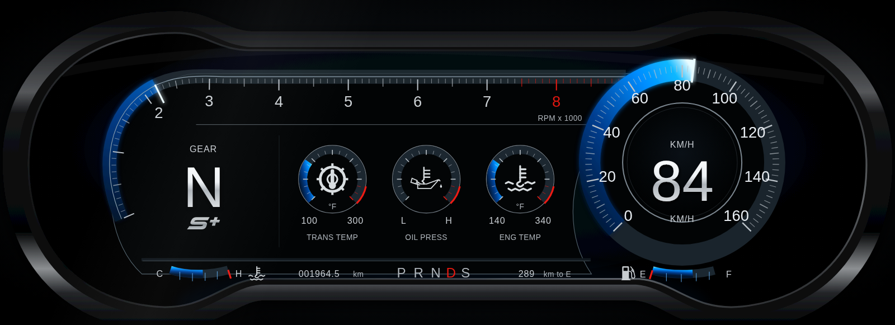
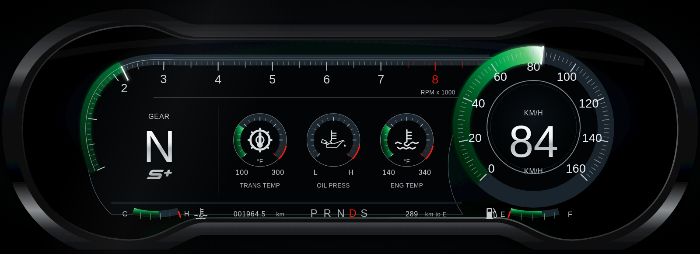
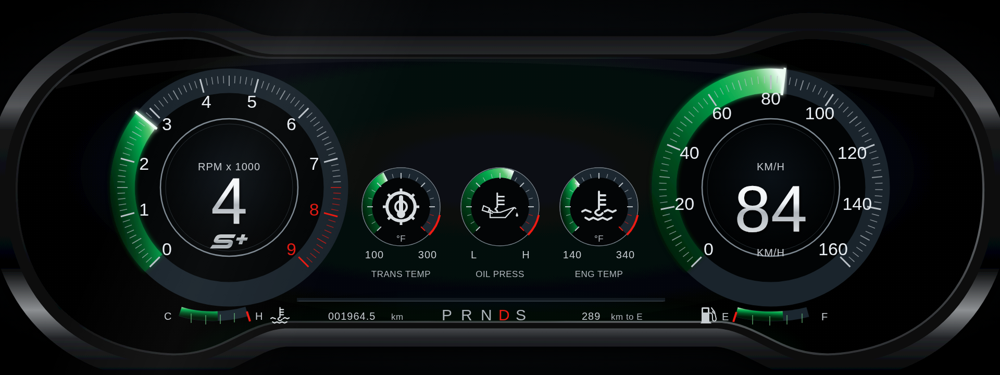

# 🚗 OBD2 Instrument Cluster
# ---------------------------------------------------------------------------#
#
#   [](https://github.com/aman-2709/obd2-instrument-cluster/actions/workflows/ci.yml)
#
# ---------------------------------------------------------------------------

## 📋 Overview

**OBD2 Instrument Cluster** is a real-time vehicle monitoring application that provides live insights into your vehicle's performance using OBD2 data. Built with .NET 8.0 backend and React frontend, it features a Mustang-themed dashboard with WebSocket-based real-time updates.

## 🙏 About This Fork

This project is a fork of [obd2dashboard](https://github.com/hitmanpc/obd2dashboard), originally created and developed by **Don Bowman** ([@hitmanpc](https://github.com/hitmanpc)).

All credit for the original project goes to Don. His work forms the foundation of this fork, which I am continuing to develop by making improvements, modifying existing functionality, and introducing new features.

A sincere thank you to Don for the time, effort, and dedication he has put into this project, and for sharing his work with the open-source community.

**Thank you, Don, for making this possible!**

This is a standalone repository rather than one made with GitHub's Fork button: the code was copied in with its full commit history, so Don's commits stay attributed to him. The original [MIT License](LICENSE) and copyright notice are kept; see also [NOTICE](NOTICE).

**Changes in this fork so far**

- **Emulator:** ELM327-emulator is pinned to v4.0.0 and started with `-i 0.0.0.0`. Without that flag it listens on loopback only inside its container, so the backend container cannot reach it. The emulator port is published on the host's loopback only.
- **Dashboard:** the WebSocket client keeps receiving telemetry after a reconnect (it used to go silent until a page reload) and no longer leaves an orphan socket behind on unmount. The hook now has unit tests.
- **Themes:** a green version of the instrument cluster next to the original blue one (see Versions and themes below).
- **RPM dial:** the tachometer is a round dial on the left, the same size and style as the km/h dial, instead of a strip across the top. The gear indicator moves into the middle of it.
- **Production frontend image:** the published frontend image is now a production build served by nginx (about 22 MB), instead of the React development server (about 1.26 GB, compiled on every start). `docker-compose.yml` still builds the development server for local work, with hot reload (`target: dev` in the compose file). CI builds both and smoke-tests the production image.
- **Production compose file:** `docker-compose.prod.yml` starts on its own. `OBD_VERSION` is required, both containers report their health, and the adapter needs no `devices:` entry. `deploy-pi.sh` deploys a released version, and CI starts the file and smoke-tests it.

## 🎨 Versions and themes

The instrument cluster is published as container images. Versions 1.0.0 to 3.0.0 differ in look; 3.1.0 keeps the look of 3.0.0 and changes how the image is built.

| Version | Look | Frontend image |
|---|---|---|
| 1.0.0 | blue | `ghcr.io/aman-2709/obd2-instrument-cluster-frontend:1.0.0` |
| 2.0.0 | green | `ghcr.io/aman-2709/obd2-instrument-cluster-frontend:2.0.0` |
| 3.0.0 | green, with a round RPM dial on the left | `ghcr.io/aman-2709/obd2-instrument-cluster-frontend:3.0.0` |
| 3.1.0 | same as 3.0.0, as a production build (nginx, about 22 MB) | `ghcr.io/aman-2709/obd2-instrument-cluster-frontend:3.1.0` |





```bash
docker run --rm -p 3000:3000 ghcr.io/aman-2709/obd2-instrument-cluster-frontend:3.1.0   # green, round RPM dial
```

The cluster shows live data from the backend on port 8000. The 3.1.0 image serves a production build and answers almost at once. The 1.0.0 to 3.0.0 images run the React development server, so they are about 1.26 GB and compile when they start; give those a few seconds, or up to 30 on slow hardware. The images are built for `linux/amd64` and `linux/arm64`, and matching `-backend` images are published with the same tags.

The colour comes from `REACT_APP_CLUSTER_THEME` (`blue` or `green`). An empty or unknown value uses the default, which is green. For example, `docker run -e REACT_APP_CLUSTER_THEME=blue …` or `REACT_APP_CLUSTER_THEME=blue docker compose up` gives the blue look on a version 2.0.0 or newer build. Version 1.0.0 predates this setting and is always blue. The 3.1.0 image reads the variable when the container starts, so you do not need to rebuild it; it accepts letters only, and anything else is ignored and gives the default.

## ✨ Features

- 📊 Real-time vehicle diagnostics via WebSocket
- 🎨 Mustang-themed interactive dashboard with custom gauges
- 🏎️ RPM gauge, speedometer, coolant temperature, and gear indicator
- 🔌 Direct ELM327 OBD2 adapter support
- 🐳 Docker containerized deployment
- 📱 Raspberry Pi deployment support
- 🔧 OBD2 emulator for testing without a vehicle

## 🛠️ Prerequisites

-  for backend
-  for frontend
-  with TypeScript
-  (for OBD2 emulator only)
- [](https://github.com/Ircama/ELM327-emulator) (optional, for testing)
- [socat](http://www.dest-unreach.org/socat/) (for virtual serial port emulation)
- Docker & Docker Compose (for containerized deployment)
- ELM327-compatible OBD2 adapter (for real vehicle connection)

## 🏗️ Architecture

- **Backend**: .NET 8.0 C# with WebSocket communication for real-time data streaming
- **Frontend**: React 19 with TypeScript and custom dashboard components
- **Communication**: AT command manager for OBD2 protocol handling
- **Deployment**: Docker Compose for containerized services
- **Target Platforms**: Linux (x64, ARM), Raspberry Pi, Windows (development)

## 📦 Setup and Installation

### Quick Start with Docker Compose

1. **Clone the repository**
```bash
git clone https://github.com/aman-2709/obd2-instrument-cluster.git
cd obd2-instrument-cluster
```

2. **Start the development stack** (backend, frontend with hot reload, and the ELM327 emulator)
```bash
docker compose up --build -d
```

Compose merges `docker-compose.override.yml` into `docker-compose.yml` automatically; that is where the emulator comes from. To run the released images instead, see Production Deployment.

3. **Access the dashboard**
- Frontend: http://localhost:3000
- Backend WebSocket: ws://localhost:8000/ws

Open the dashboard in a browser on the machine that runs the containers. From another device the page loads but shows no data yet: it connects to `ws://localhost:8000/ws` only when it is opened as `localhost`, and to `ws://obd_backend:8000/ws` (a name only the containers can resolve) from any other address.

### Stop Services

```bash
docker compose down
```

### Production Deployment

The production file runs released images from GHCR. Name the version to run (from the table above; the examples use 3.1.0); it is required, there is no `latest` image:
```bash
OBD_VERSION=3.1.0 docker compose -f docker-compose.prod.yml up -d
```

Use the file on its own. Merged with `docker-compose.yml` it would pull in the development server and the source bind mounts. The adapter defaults to `/dev/ttyUSB0`; set `OBD_PORT` (for example `OBD_PORT=/dev/ttyACM0`) to use another device. Both containers report their health, so `docker compose -f docker-compose.prod.yml ps` shows `(healthy)` once they are up. The backend's check only confirms that port 8000 accepts connections.

The nginx reverse proxy is optional and off by default. Add `--profile with-nginx` to start it; it needs `ssl/cert.pem` and `ssl/key.pem` next to the compose file.

`./deploy-pi.sh` does all of this on a Raspberry Pi. It works in `~/obd2dashboard` (cloning the repository there on the first run) and deploys the newest release tag, or the one you name: `OBD_VERSION=3.1.0 ./deploy-pi.sh`.

### Raspberry Pi Deployment

See the [Quick Start Guide](QUICKSTART.md) for streamlined Raspberry Pi deployment, or [detailed Raspberry Pi deployment docs](docs/raspberry-pi-deployment.md) for step-by-step instructions.

```bash
# One-command deployment on Raspberry Pi
curl -fsSL https://raw.githubusercontent.com/aman-2709/obd2-instrument-cluster/main/deploy-pi.sh -o deploy-pi.sh
chmod +x deploy-pi.sh
./deploy-pi.sh
```

## 🚀 Development Setup

### Running Backend Locally (without Docker)

1. **Navigate to backend directory**
```bash
cd backend
```

2. **Build the project**
```bash
dotnet build
```

3. **Run the application**
```bash
dotnet run
```

Or use the VS Code tasks:
- Press `Ctrl+Shift+B` to build
- Use "watch" task for auto-reload during development

### Running Frontend Locally (without Docker)

1. **Navigate to frontend directory**
```bash
cd frontend
```

2. **Install dependencies**
```bash
npm install
```

3. **Start development server**
```bash
npm start
```

The frontend will be available at http://localhost:3000

## 🧪 Running with OBD2 Emulator (No Vehicle Required)

### Start OBD2 Emulator

Before starting the application, start the OBD2 emulator to simulate vehicle data:

```bash
cd emulator
python -m elm -n 35000 --daemon
```

You should see: `ELM327-emulator daemon service STARTED on /dev/pts/<x>`

**Check emulator status:**
```bash
ps aux | grep elm
```

**Stop emulator:**
```bash
kill <pid>
```

### Using Virtual Serial Port (tcp2UsbScript.sh)

To create a virtual serial port mapped to the emulator:

```bash
cd emulator
./tcp2UsbScript.sh
```

This script will:
- Start the ELM327 emulator as a daemon on TCP port 35000
- Create a virtual serial port at `/virtual/usb1` using socat
- Monitor and auto-restart the emulator if it crashes
- Clean up processes on exit

## 🔌 Connecting to Real OBD2 Adapter

1. **Connect your ELM327 OBD2 adapter** via USB to your computer/Raspberry Pi
2. **Find the device**: `ls /dev/ttyUSB*` or `ls /dev/ttyACM*`
3. **Point the backend at it.** The backend reads `OBD_PORT`, and each way of starting the stack sets it differently:
   - Released images (`docker-compose.prod.yml`): set it in the environment. The default is `/dev/ttyUSB0`.
     ```bash
     OBD_PORT=/dev/ttyACM0 OBD_VERSION=3.1.0 docker compose -f docker-compose.prod.yml up -d
     ```
   - Development stack: plain `docker compose up` adds the emulator through `docker-compose.override.yml`, which sets `OBD_PORT=/virtual/usb1`, so your adapter would not be used. Name the base file to skip the override, and edit the `OBD_PORT` line in `docker-compose.yml` if your adapter is not `/dev/ttyUSB0`:
     ```bash
     docker compose -f docker-compose.yml up --build -d
     ```

The backend container runs privileged, so it sees the host's devices and needs no `devices:` entry. (An entry would stop the container from starting whenever the adapter is unplugged.)

## ✅ Verify Installation

### Check Backend
The backend has no web page: opening `http://localhost:8000` returns 404. Its only route is the WebSocket at `ws://localhost:8000/ws`, which the dashboard connects to, so live values on the dashboard mean the backend is working.

### Check Frontend
Open your browser and navigate to:
```
http://localhost:3000
```

You should see the Mustang-themed dashboard:


## 🔧 Configuration

### Backend Configuration

**Main files:**
- [`backend/src/Program.cs`](backend/src/Program.cs) - Application entry point and WebSocket setup
- [`backend/src/Services/ObdService.cs`](backend/src/Services/ObdService.cs) - OBD2 communication service
- [`backend/src/Commands/AtCommands.cs`](backend/src/Commands/AtCommands.cs) - AT command definitions
- [`backend/appsettings.json`](backend/appsettings.json) - Application configuration

**Environment Variables:**
- `OBD_PORT` - Serial port for OBD2 adapter (default: `/virtual/usb1`)

### Frontend Configuration

**Main files:**
- [`frontend/src/components/MustangDashboard.tsx`](frontend/src/components/MustangDashboard.tsx) - Main dashboard UI
- [`frontend/src/hooks/useWebSocket.ts`](frontend/src/hooks/useWebSocket.ts) - WebSocket connection hook
- [`frontend/src/types/index.ts`](frontend/src/types/index.ts) - TypeScript type definitions

**Customize the dashboard:**
- Modify gauge components in [`frontend/src/components/`](frontend/src/components/)
- Update styling in `*.css` files
- Configure OBD PIDs in backend configuration

### OBD2 PID Configuration

Configure which OBD2 parameters to query in:
- [`backend/src/Configuration/ObdPidConfiguration.cs`](backend/src/Configuration/ObdPidConfiguration.cs)

## 🛠️ Troubleshooting

### OBD2 Connection Issues

- ❗ **Cannot connect to OBD2 adapter**
  - Verify device is connected: `ls /dev/ttyUSB*` or `ls /dev/ttyACM*`
  - Check permissions: `sudo chmod 666 /dev/ttyUSB0`
  - Add user to dialout group: `sudo usermod -aG dialout $USER && sudo reboot`
  - Verify OBD_PORT environment variable is correct

- ❗ **Emulator not working**
  - Ensure Python ELM327 emulator is installed: `pip install ELM327-emulator`
  - Check if emulator is running: `ps aux | grep elm`
  - Verify virtual serial port exists: `ls /virtual/usb1`
  - Ensure socat is installed: `sudo apt-get install socat`

### Backend Issues

- ❗ **Backend won't start**
  - Verify .NET 8.0 SDK is installed: `dotnet --version`
  - Check for port conflicts on port 8000
  - Review logs: `docker compose logs obd_backend`
  - Ensure serial port device is accessible

- ❗ **WebSocket connection failed**
  - Check backend is running and accessible
  - Verify firewall allows WebSocket connections
  - Ensure CORS is properly configured for your domain

### Frontend Issues

- ❗ **Dashboard not loading**
  - Verify Node.js is installed: `node --version`
  - Clear npm cache: `npm cache clean --force`
  - Delete node_modules and reinstall: `rm -rf node_modules && npm install`
  - Check for port conflicts on port 3000

- ❗ **No data displayed**
  - Is the page open on another device? Data only shows in a browser on the machine that runs the backend (see Quick Start)
  - Verify WebSocket connection in browser console
  - Check backend logs for OBD2 communication errors
  - Ensure OBD2 adapter/emulator is responding

### Docker Issues

- ❗ **Permission denied**
  - Add user to docker group: `sudo usermod -aG docker $USER`
  - Reboot system: `sudo reboot`

- ❗ **Cannot access devices in container**
  - Check that `OBD_PORT` is the adapter's device (see Connecting to Real OBD2 Adapter). The compose files run the backend privileged, so no device mapping is needed
  - Starting the backend with plain `docker run`? Pass the device with `--device /dev/ttyUSB0` (or `--privileged`, not recommended for production)

### Raspberry Pi Specific

- ❗ **Insufficient memory**
  - Increase swap size
  - Use the production images instead of the development server: `OBD_VERSION=3.1.0 docker compose -f docker-compose.prod.yml up -d`

- ❗ **Slow performance**
  - Ensure using ARM-optimized images
  - Consider pre-building on faster machine and deploying image

For more help, check the [Raspberry Pi deployment guide](docs/raspberry-pi-deployment.md) or create an issue on GitHub.

## 📁 Project Structure

```
obd2-instrument-cluster/
├── backend/              # .NET 8.0 C# backend
│   ├── src/
│   │   ├── Program.cs              # Application entry point
│   │   ├── Commands/               # AT command definitions
│   │   ├── Communication/          # OBD2 communication layer
│   │   ├── Configuration/          # OBD PID configurations
│   │   └── Services/               # ObdService, WebSocketService
│   ├── appsettings.json           # App configuration
│   └── ObdDashboard.csproj        # .NET project file
├── frontend/             # React TypeScript frontend
│   ├── src/
│   │   ├── components/            # Dashboard UI components
│   │   │   └── MustangDashboard.tsx
│   │   ├── hooks/                 # React hooks (WebSocket)
│   │   └── types/                 # TypeScript definitions
│   └── package.json
├── emulator/             # OBD2 emulator for testing
│   ├── tcp2UsbScript.sh          # Virtual serial port setup
│   └── Dockerfile
├── docs/                 # Documentation
│   └── raspberry-pi-deployment.md
├── docker-compose.yml    # Development setup
├── docker-compose.prod.yml        # Production setup
├── deploy-pi.sh          # Raspberry Pi deployment script
└── README.md
```

## 🤝 Contributing

We welcome contributions! Here's how to get started:

1. 🍴 **Fork the repository**
2. 🌿 **Create a feature branch**
   ```bash
   git checkout -b feature/your-feature-name
   ```
3. 💾 **Commit your changes**
   ```bash
   git commit -m "Add your feature description"
   ```
4. 📤 **Push to the branch**
   ```bash
   git push origin feature/your-feature-name
   ```
5. 🔀 **Create a Pull Request**

### Development Guidelines

- Follow C# coding conventions for backend (.NET guidelines)
- Use TypeScript and follow React best practices for frontend
- Write meaningful commit messages
- Test your changes with both emulator and real OBD2 adapter (if possible)
- Update documentation as needed

## 📄 License

This project is licensed under the [MIT License](./LICENSE). You are free to use, modify, and distribute this software, provided you give appropriate credit.

## 🔗 Resources

- [ELM327 Command Reference](https://www.elmelectronics.com/wp-content/uploads/2017/01/ELM327DS.pdf)
- [OBD2 PIDs Wikipedia](https://en.wikipedia.org/wiki/OBD-II_PIDs)
- [ELM327 Emulator](https://github.com/Ircama/ELM327-emulator)
- [.NET 8.0 Documentation](https://learn.microsoft.com/en-us/dotnet/)
- [React Documentation](https://react.dev/)

## 📞 Contact

**Original project**: [hitmanpc/obd2dashboard](https://github.com/hitmanpc/obd2dashboard) by Don Bowman  
**Issues**: https://github.com/aman-2709/obd2-instrument-cluster/issues

---

**Built with ❤️ for car enthusiasts and developers**